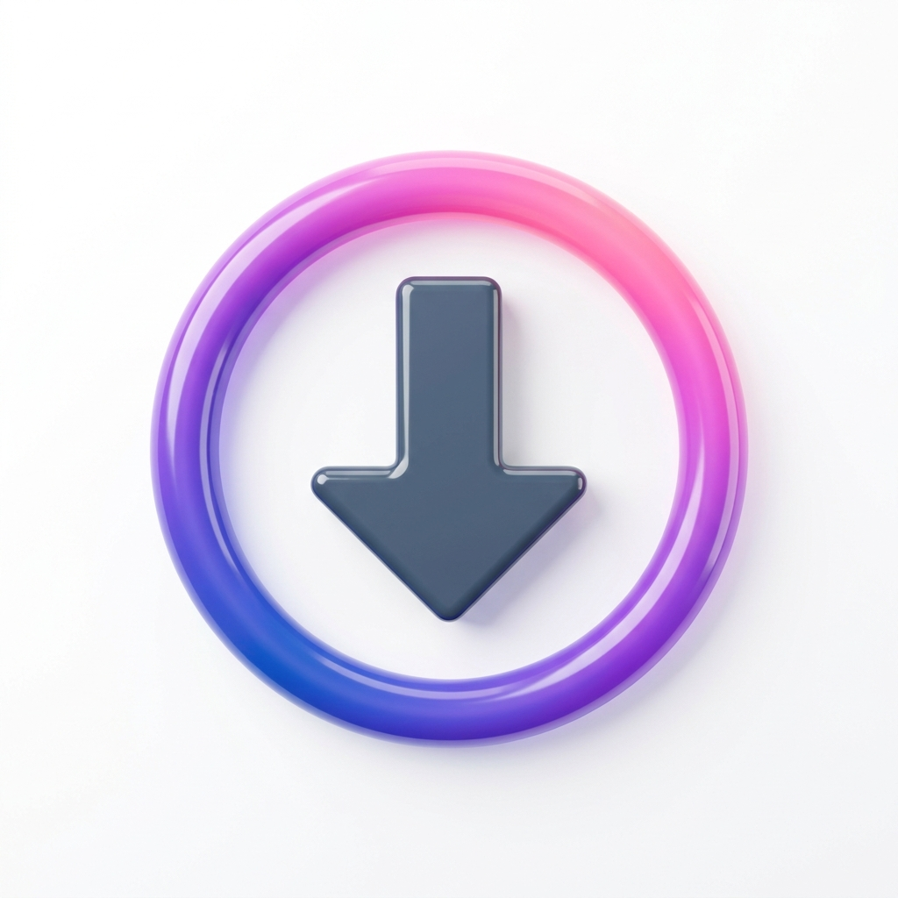

    
  <h1>Media Saver</h1>
  
Android-приложение, которое сохраняет видео и карусели из TikTok прямо в вашу Telegram-группу — без авторизации в TikTok.

[English](README.md) &nbsp;|&nbsp; [Русский](README-ru.md)

---

## ✨ Возможности

- **Поделиться одним нажатием** — нажмите «Поделиться» в TikTok, выберите Media Saver, подтвердите. Готово — ваше видео сохранится в группу!
- **Видео и карусели** — скачивает как одиночные видео, так и полные карусели (отправляет альбомом).
- **Прямо в Telegram** — загружает в группу через Bot API с заголовком и ссылкой на оригинальный пост.
- **Работает в фоне** — вам не нужно постоянно переходить в приложение и обратно.
- **История загрузок** — каждая загрузка сохраняется локально на телефоне с превью, статусом и ссылкой на сообщение в Telegram.
- **Без авторизации в TikTok** — работает с любой публичной ссылкой.

---

## 📲 Установка

1. Откройте страницу [**Releases**](https://github.com/YOUR_USERNAME/YOUR_REPO/releases/latest).
2. Скачайте последний `.apk`-файл.
3. Откройте APK на телефоне и нажмите **Установить**.  
   *(При необходимости разрешите установку из неизвестных источников: Настройки → Приложения → Особые права доступа.)*

**Требуется Android 8.0 и выше.**

---

## ⚙️ Настройка (один раз)

Приложению нужен Telegram-бот и группа, куда оно будет отправлять файлы.

### 1. Создайте бота

1. Откройте [@BotFather](https://t.me/BotFather) в Telegram.
2. Отправьте `/newbot`, придумайте имя и username.
3. Скопируйте **токен** (выглядит как `123456789:AAExxxxxx…`).

> [!CAUTION]
> Токен — это пароль вашего бота. Никому его не передавайте. Если он утёк — отзовите через `/revoke` у @BotFather.

### 2. Добавьте бота в группу

1. Создайте или откройте Telegram-**группу** (не канал и не личный чат).
2. Добавьте бота в участники.
3. Назначьте его **администратором** с правом **Публикации сообщений** — без этого загрузки будут падать с ошибкой `403`.

### 3. Узнайте Chat ID группы

Chat ID всегда начинается с `-100` (например, `-1001234567890`). Как найти:

- **Поделитесь группой** с ботом [@username_to_id_bot](https://t.me/username_to_id_bot) — откройте бота, нажмите скрепку, выберите чат, укажите группу — бот сразу ответит Chat ID.

### 4. Введите данные в приложение

1. Откройте **Media Saver** → нажмите значок ⚙️.
2. В блоке **Telegram API** вставьте:
   - **Bot Token** — токен из шага 1.
   - **Group ID** — Chat ID из шага 3 (начинается с `-100`).
3. Нажмите **Проверить доступ**.
   - ✅ *Подключение успешно* — всё готово.
   - ❌ `Unauthorized` — неверный токен.
   - ❌ `chat not found` — неверный Group ID или бот не в группе.
   - ❌ `not enough rights` — бот не администратор.
4. Нажмите **Сохранить**.

---

## 🚀 Как пользоваться

| Способ | Шаги |
|---|---|
| **Поделиться из TikTok** *(рекомендуется)* | Нажмите «Поделиться» в TikTok → выберите **Media Saver** → подтвердите |
| **Вставить ссылку вручную** | Откройте Media Saver → вставьте ссылку TikTok → нажмите кнопку загрузки |
| **Открыть ссылку напрямую** | Нажмите на ссылку `tiktok.com` → выберите **Открыть в Media Saver** |

Приложение автоматически находит TikTok-ссылку в любом тексте, даже если вместе с ней есть лишние символы.

---

## ⚠️ Известные ограничения

| Проблема | Подробности |
|---|---|
| **Лимит 50 МБ на видео** | Telegram Bot API принимает видео не более 50 МБ. Приложение делает одну попытку в более низком качестве; если файл всё равно больше — завершится с явной ошибкой. Видео не режется и не перекодируется. |
| **Сторонний API** | Получение ссылки на файл зависит от [tikwm.com](https://tikwm.com). Если сервис недоступен или превышен лимит запросов — загрузка не удастся. |
| **Настройки не резервируются** | Токен бота хранится в зашифрованном виде и намеренно исключён из облачного резервного копирования Android. На новом устройстве его нужно ввести заново. |
| **Только публичные посты** | Поддерживаются только публичные TikTok-ссылки — приватные аккаунты не поддерживаются. |

---

## 🔧 Решение проблем

| Симптом | Решение |
|---|---|
| «Токен бота или Group ID не заполнены» | Откройте Настройки → Telegram API и заполните оба поля. |
| `Unauthorized` | Неверный токен — проверьте его у @BotFather и вставьте заново. |
| `chat not found` | Неверный Group ID или бот не добавлен в группу. |
| `not enough rights` / 403 | Выдайте боту право **Публикации сообщений** в настройках администраторов. |
| «Файл слишком большой (>50 МБ)» | Жёсткий лимит Telegram Bot API — см. выше. |
| Загрузка не начинается | Проверьте интернет-соединение и разрешения на уведомления (Android 13+). |
